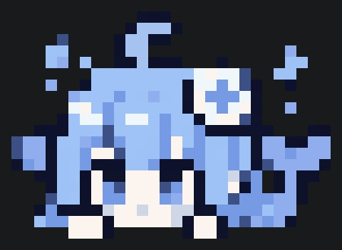

# CC Logo Switch

[中文说明](README.zh-CN.md) · [How it works](docs/how-it-works.md)

Turn your PNG into a **color pixel-art icon inside Claude Code's native welcome header**. Keep the version, model and working-directory information beside it.

The PNG is converted into colored `▀` / `▄` text cells. This is a native text-rendered icon, not a Kitty PNG overlay or an extra startup splash.

| Input PNG | Actual Claude startup icon · VS Code |
| --- | --- |
|  |  |

The right image is cropped from the actual Claude Code startup screen in VS Code, retaining its terminal colors, background and proportions. The sample is AI-generated DeepSeek-inspired artwork; you can use your own PNG.

The [raw RGB pixel grid](docs/assets/pixel-preview.svg) is a conversion diagnostic, not a screenshot of the installed result. Terminal color mapping, font metrics and background affect how the icon looks.

## Compatibility

| Item | Supported / tested |
| --- | --- |
| Claude Code | **2.1.318 and 2.1.319**, native macOS ARM64 installation |
| Build / install / restore | macOS Apple Silicon |
| Preview | Python-supported platforms |
| Python | 3.9+ |
| Dependencies | Pillow, Node.js for JavaScript syntax checks, macOS `codesign` |
| Terminal tested | VS Code 1.144.1; colored block characters, no image protocol required |

This initial release deliberately rejects other Claude versions and unfamiliar header layouts. Claude updates may overwrite the patch. There is no automatic update hook.

## Install the tool

Keep the checkout outside `Documents` if macOS prevents your terminal from accessing that folder:

```bash
mkdir -p ~/.local/share
cd ~/.local/share
git clone https://github.com/ArthurYangX/cc-logo-switch.git
cd cc-logo-switch
python3 -m venv .venv
source .venv/bin/activate
python -m pip install .
```

The earlier `claude-logo-switch` and `png-to-claude` commands remain available as aliases. The installation-record location remains unchanged so existing backups can still be restored.

Node.js must also be available as `node` when building or installing a header patch.

## Preview your image

```bash
cc-logo-switch preview ~/Downloads/avatar.png
cc-logo-switch preview ~/Downloads/avatar.png --width 24
cc-logo-switch preview ~/Downloads/avatar.png --svg /tmp/avatar-preview.svg
```

Transparent pixels reveal the terminal background. The converter uses nearest-neighbor resizing, a maximum of 15 opaque colors, and an alpha threshold of 128. Each terminal row contains two rows of pixels. The default width is 28 columns; even widths from 12 to 32 are accepted. Very tall or complex images can exceed the fixed patch budget and are rejected.

## Build a separate executable first

```bash
cc-logo-switch build ~/Downloads/avatar.png \
  --output ~/.local/share/cc-logo-switch/claude-preview

~/.local/share/cc-logo-switch/claude-preview
```

This leaves your installed Claude untouched. The output filename must not already exist. The tool validates the JavaScript, signs the new executable, verifies its signature, and checks `--version`. You can then inspect the welcome header interactively.

The default source is `~/.local/bin/claude`; use `--target /path/to/claude` for another native installation.

## Install the header

```bash
cc-logo-switch install ~/Downloads/avatar.png
```

This builds and validates a candidate, saves a checksummed backup next to your current executable, and replaces the executable atomically. Existing customizations outside the header are preserved. The installation record is stored at:

```text
~/.config/png-to-claude-code/installation.json
```

Open a **new Claude session** to see the icon. Existing sessions and their processes are left running. No API keys, models, shell launchers or splash settings are changed.

Already using a header patch? Restore it with the tool that installed it before running this installer; it refuses to patch an already-patched header.

## Restore

```bash
cc-logo-switch restore
```

Restoration verifies both the installed file and the backup. If Claude has since been updated or modified, restoration refuses to overwrite it. `--state /path/to/installation.json` selects a separate installation record for both `install` and `restore`.

Backups are retained after restoration; they are not committed or uploaded by this tool.

## Development and validation

```bash
python -m pip install -e .
python -m unittest discover -s tests -v
```

Tests use synthetic executable fixtures, not redistributed Claude binaries. They cover transparent cells, character encoding, patch boundaries, architecture/version rejection, installation, restoration and changed-file detection. The 2.1.318 and 2.1.319 implementations were additionally checked locally with a real interactive terminal: colored header, text input, window resizing and normal exit.

[Implementation notes](docs/how-it-works.md) explain the fixed-length patch and the Bun bytecode-cache invalidation needed for the changed module.

## Credits and license

MIT. The project was informed by [claude-custom-banner](https://github.com/arian-shamaei/claude-custom-banner); its attribution is retained in [THIRD_PARTY_NOTICES.md](THIRD_PARTY_NOTICES.md). Bun's public module-graph implementation was used to interpret the executable format.

No Claude executable, extracted bundle, local installation manifest or credentials are included in this repository. This is an unofficial customization tool, unaffiliated with Anthropic or DeepSeek.
